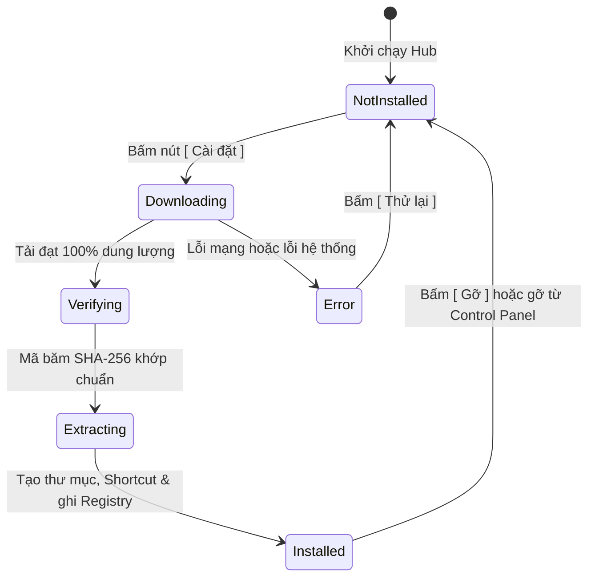

# ĐẶC TẢ KỸ THUẬT: PACKAGE MANAGER & WINDOWS CONTROL PANEL INTEGRATION

Tài liệu này đặc tả cơ chế quản lý gói cài đặt, hệ thống tải dữ liệu nền và cơ chế tích hợp đăng ký trực tiếp vào **Windows Control Panel (`appwiz.cpl`)** của dự án Nom Office Suite.

---

## 1. MÁY TRẠNG THÁI GÓI CÀI ĐẶT (PACKAGE STATE MACHINE)

Toàn bộ ứng dụng trong hệ thống chuyển dịch qua các trạng thái nghiêm ngặt được mô tả trong struct `AppStatus`:



---

## 2. CƠ CHẾ TẢI XUỐNG DỮ LIỆU ("NÓ CÓ TẢI")

Được triển khai trong tệp [**`crates/package/src/downloader.rs`**](file:///E:/DATA/source/Nom/nomr/crates/package/src/downloader.rs):

### 2.1 Kiến trúc bất đồng bộ
- Mỗi tiến trình tải chạy trên một luồng ngầm bất đồng bộ bằng `tokio::spawn`.
- Trạng thái được đẩy về luồng chính của giao diện thông qua kênh truyền tin đa sản xuất đơn tiêu thụ `tokio::sync::mpsc::channel`.
- Không làm đơ (freeze) giao diện người dùng.

### 2.2 Các thông số hiển thị thời gian thực
- **Phần trăm hoàn thành (`progress: f32`)**: Giá trị từ `0.0` đến `1.0` điều khiển độ rộng của thanh tiến trình hình học phẳng.
- **Tốc độ tải (`speed_mbps: f32`)**: Đo lường tốc độ mạng trung bình (hiển thị dạng `18.5 MB/s`).
- **Dung lượng đã tải (`downloaded_mb: f32`)**: Hiển thị tỷ lệ dung lượng trực quan (ví dụ: `14.2 / 28.4 MB`).

---

## 3. TÍCH HỢP WINDOWS CONTROL PANEL (`appwiz.cpl`)

Để mỗi ứng dụng hiển thị riêng biệt trong danh sách **Programs and Features** của hệ thống Windows mà **không cần quyền Quản trị viên (UAC Admin)**, Nom Package can thiệp vào registry của người dùng hiện tại (`HKEY_CURRENT_USER`).

Được triển khai trong tệp [**`crates/package/src/platform/windows/control_panel.rs`**](file:///E:/DATA/source/Nom/nomr/crates/package/src/platform/windows/control_panel.rs):

### 3.1 Đường dẫn khóa Registry độc lập
Mỗi ứng dụng có một khóa con duy nhất theo định danh:
```
HKCU\Software\Microsoft\Windows\CurrentVersion\Uninstall\Nom_<app_id>
```
*Ví dụ đối với Nom Writer:*
`HKCU\Software\Microsoft\Windows\CurrentVersion\Uninstall\Nom_writer`

### 3.2 Các trường dữ liệu chuẩn được thiết lập
| Tên trường (Value Name) | Kiểu dữ liệu | Giá trị mẫu | Mục đích hiển thị |
| :--- | :--- | :--- | :--- |
| **`DisplayName`** | `REG_SZ` | `Nom Writer (Docs)` | Tên xuất hiện trong bảng danh sách ứng dụng Control Panel |
| **`DisplayVersion`** | `REG_SZ` | `1.0.0` | Cột phiên bản ứng dụng |
| **`Publisher`** | `REG_SZ` | `Nom Office` | Cột nhà phát triển phần mềm |
| **`InstallLocation`** | `REG_SZ` | `C:\Users\...\AppData\Local\NomOffice\writer` | Thư mục lưu trữ ứng dụng |
| **`DisplayIcon`** | `REG_SZ` | `C:\Users\...\AppData\Local\NomOffice\writer\nom-writer.exe` | Biểu tượng icon hiển thị |
| **`UninstallString`** | `REG_SZ` | `cmd.exe /c "...\uninstall.cmd"` | Lệnh Windows gọi khi người dùng bấm nút [ Uninstall ] |
| **`QuietUninstallString`** | `REG_SZ` | `cmd.exe /c "...\uninstall.cmd"` | Lệnh gỡ bỏ chế độ nền |
| **`NoModify`** | `REG_DWORD` | `1` | Khóa nút Modify trên thanh công cụ |
| **`NoRepair`** | `REG_DWORD` | `1` | Khóa nút Repair |
| **`EstimatedSize`** | `REG_DWORD` | `29081` (tính theo KB) | Cột dung lượng chiếm dụng ổ đĩa |

---

## 4. CƠ CHẾ GỠ CÀI ĐẶT HAI CHIỀU (TWO-WAY SYNC)

Hệ thống hỗ trợ việc gỡ cài đặt từ cả 2 phía:

1. **Trường hợp gỡ từ Windows Control Panel (`appwiz.cpl`)**:
   - Khi người dùng vào Control Panel $\rightarrow$ Chuột phải vào ứng dụng $\rightarrow$ Bấm [ Uninstall ].
   - Windows thực thi tệp script độc lập [**`uninstall.cmd`**](file:///E:/DATA/source/Nom/nomr/crates/package/src/platform/windows/script.rs).
   - Tệp script xóa khóa Registry tương ứng, xóa shortcut Desktop `.lnk`, xóa shortcut Start Menu, và xóa sạch thư mục cài đặt.
   - Khi Nom Launcher đang mở hoặc được khởi động lại, hàm [**`sync_installed_status`**](file:///E:/DATA/source/Nom/nomr/crates/package/src/sync.rs) sẽ phát hiện ứng dụng đã không còn trong Registry/ổ đĩa, và tự động chuyển giao diện từ `[ Mở ] [ Gỡ ]` về `[ Cài đặt ]`.

2. **Trường hợp gỡ từ Nom Launcher**:
   - Khi người dùng bấm nút `[ Gỡ ]` trên giao diện Hub.
   - Hàm `uninstall_app` gọi trực tiếp `unregister_control_panel` xóa Registry, `remove_shortcuts` xóa shortcut, và `remove_dir_all` dọn sạch thư mục.
   - Ngay lập tức mục ứng dụng tương ứng biến mất khỏi Windows Control Panel.
